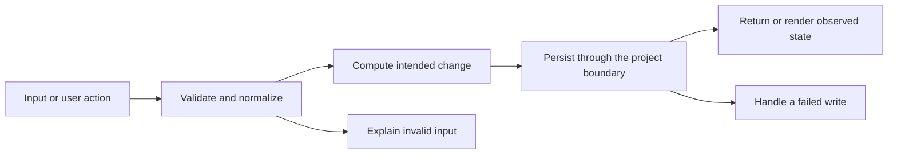

# Codebase map and reading order

[Course index](README.md)

## The problem this project solves

The project already had CRUD routes and validation. It lacked executable regression coverage for the complete path, allowed unsafe integer ids and overlong titles to reach deeper layers, and could reject editing an overdue task when its unchanged date was resubmitted. The improvement you will study is: The API rejects unsafe ids and titles longer than the database column. An unchanged existing due date remains editable; new or changed due dates still follow the future-date rule. Tests call real HTTP routes and inspect PostgreSQL rows, including completion timestamps and deletion.

## Data model

A SQL task includes id, title, description, priority, status, due_date and completion timestamps. The database id is a positive integer. A partial update distinguishes an omitted field from a supplied null or value.

An object is a named collection of fields. An array is an ordered collection of values. An id answers “which record?”; an index answers “where is it in this array right now?” Those questions are different whenever the list can be filtered, reordered or edited. Persisted data is the form that must survive a process/page restart. Derived data can be recomputed from that persisted state.

## Trace one action

1. React submits a task payload through its API service.
2. Express routes select the controller.
3. The controller delegates to taskService.
4. Validation normalizes supported fields and rejects invalid input.
5. taskModel writes with Knex and returns the stored row.
6. The client refreshes tasks and stats from API responses.

This diagram names responsibilities, not necessarily separate files. A small browser program can keep them in app.js. A larger API spreads them across controllers, services and models. Follow the actual sequence above rather than assuming every repository has the same architecture.

## Where to read first

1. [server/src/services/taskService.js](../server/src/services/taskService.js): locate `buildUpdatePayload` and read its inputs, branches and return/side effects.
2. [server/test/tasks.test.cjs](../server/test/tasks.test.cjs): read the scenario names before the helper code.
3. The root [README](../README.md): connect setup and the larger application workflow.

## Source navigation

- [client/src/App.jsx](../client/src/App.jsx)
- [client/src/components/ui/Badge.jsx](../client/src/components/ui/Badge.jsx)
- [client/src/components/ui/Button.jsx](../client/src/components/ui/Button.jsx)
- [client/src/components/ui/EmptyState.jsx](../client/src/components/ui/EmptyState.jsx)
- [client/src/components/ui/Input.jsx](../client/src/components/ui/Input.jsx)
- [client/src/components/ui/Modal.jsx](../client/src/components/ui/Modal.jsx)
- [client/src/components/ui/Select.jsx](../client/src/components/ui/Select.jsx)
- [client/src/features/tasks/components/TaskCard.jsx](../client/src/features/tasks/components/TaskCard.jsx)
- [client/src/features/tasks/components/TaskFilters.jsx](../client/src/features/tasks/components/TaskFilters.jsx)
- [client/src/features/tasks/components/TaskForm.jsx](../client/src/features/tasks/components/TaskForm.jsx)
- [client/src/features/tasks/components/TaskList.jsx](../client/src/features/tasks/components/TaskList.jsx)
- [client/src/features/tasks/components/TaskStats.jsx](../client/src/features/tasks/components/TaskStats.jsx)
- [client/src/features/tasks/hooks/useTasks.js](../client/src/features/tasks/hooks/useTasks.js)
- [client/src/features/tasks/utils/taskHelpers.js](../client/src/features/tasks/utils/taskHelpers.js)
- [client/src/layouts/AppLayout.jsx](../client/src/layouts/AppLayout.jsx)
- [client/src/main.jsx](../client/src/main.jsx)
- [client/src/pages/TasksPage.jsx](../client/src/pages/TasksPage.jsx)
- [client/src/services/apiClient.js](../client/src/services/apiClient.js)
- [client/src/services/tasksApi.js](../client/src/services/tasksApi.js)
- [client/src/utils/classNames.js](../client/src/utils/classNames.js)
- [client/vite.config.js](../client/vite.config.js)
- [server/db/migrations/20260703000000_create_tasks_table.js](../server/db/migrations/20260703000000_create_tasks_table.js)
- [server/db/seeds/01_tasks.js](../server/db/seeds/01_tasks.js)
- [server/knexfile.js](../server/knexfile.js)
- [server/src/app.js](../server/src/app.js)
- [server/src/config/database.js](../server/src/config/database.js)
- [server/src/config/env.js](../server/src/config/env.js)
- [server/src/controllers/taskController.js](../server/src/controllers/taskController.js)
- [server/src/middleware/errorMiddleware.js](../server/src/middleware/errorMiddleware.js)
- [server/src/models/taskModel.js](../server/src/models/taskModel.js)
- [server/src/routes/taskRoutes.js](../server/src/routes/taskRoutes.js)
- [server/src/server.js](../server/src/server.js)
- [server/src/services/taskService.js](../server/src/services/taskService.js)
- [server/src/utils/asyncHandler.js](../server/src/utils/asyncHandler.js)
- [server/src/utils/errors.js](../server/src/utils/errors.js)
- [server/src/utils/response.js](../server/src/utils/response.js)
- [server/src/utils/sanitize.js](../server/src/utils/sanitize.js)

## A practical reading technique

At each function boundary, write down the value coming in, the value going out and any side effect. A side effect includes a storage write, SQL query, network request, timer registration or DOM update. If a function calls another function, inspect only that next dependency until you can finish the chosen trace. Return to unrelated files later.

For this lesson, start with: **Create a high-priority task due 2099-01-01, filter for high priority, mark it done, reopen it and delete it. Separately seed a task due 2020-01-01: editing its title with that same due date succeeds, but changing it to another past date fails.** Mark where the id, time, amount or other important value changes representation. For example, JSON serializes values into text; a date field may be a calendar string; SQL aggregates may return a different type from individual rows. Representation changes are common bug locations.

## Check your understanding

Without reading the solution, answer: Who owns the mutable state? Which input is untrusted? Which function first decides whether the operation is valid? What survives reload or restart? What observation would prove that the operation partially failed? Point to a source file for each answer, rather than describing a generic app from memory.
