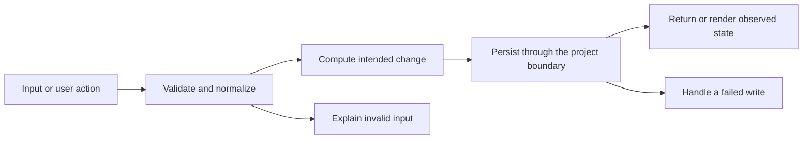

# Codebase map and reading order

[Course index](README.md)

## The problem this project solves

The old parser split lines and commas directly, corrupting quoted commas and multiline fields. Import inserted one contact at a time, skipped some invalid rows and did not make the whole batch atomic. The improvement you will study is: The parser supports quoted commas, doubled quotes, multiline text, CRLF and a BOM. It rejects malformed quoting, duplicate/unsupported headers and inconsistent field counts. The complete batch is validated before a single transaction writes contacts and tags. A late uniqueness failure rolls back earlier rows.

## Data model

Contacts and tags have a many-to-many relationship through contact_tags. CSV headers are a supported allowlist; first_name and last_name are required. The tags field uses pipe-separated names. Email uniqueness also exists in PostgreSQL.

An object is a named collection of fields. An array is an ordered collection of values. An id answers “which record?”; an index answers “where is it in this array right now?” Those questions are different whenever the list can be filtered, reordered or edited. Persisted data is the form that must survive a process/page restart. Derived data can be recomputed from that persisted state.

## Trace one action

1. The import endpoint receives CSV text.
2. csvToContacts tokenizes quoted fields and validates headers/row widths.
3. The service validates every contact and tag name.
4. importContactBatch opens one transaction.
5. Contacts, tags and junction rows are written through that transaction.
6. A failure rolls everything back; success returns the created batch.

This diagram names responsibilities, not necessarily separate files. A small browser program can keep them in app.js. A larger API spreads them across controllers, services and models. Follow the actual sequence above rather than assuming every repository has the same architecture.

## Where to read first

1. [server/src/utils/csv.js](../server/src/utils/csv.js): locate `csvToContacts` and read its inputs, branches and return/side effects.
2. [server/test/import.test.cjs](../server/test/import.test.cjs): read the scenario names before the helper code.
3. The root [README](../README.md): connect setup and the larger application workflow.

## Source navigation

- [client/src/App.jsx](../client/src/App.jsx)
- [client/src/components/ui/Button.jsx](../client/src/components/ui/Button.jsx)
- [client/src/features/contacts/useDebounce.js](../client/src/features/contacts/useDebounce.js)
- [client/src/main.jsx](../client/src/main.jsx)
- [client/src/services/api.js](../client/src/services/api.js)
- [client/vite.config.js](../client/vite.config.js)
- [server/db/migrations/202607030201_create_contacts_tags.js](../server/db/migrations/202607030201_create_contacts_tags.js)
- [server/db/seeds/001_contacts.js](../server/db/seeds/001_contacts.js)
- [server/knexfile.js](../server/knexfile.js)
- [server/src/app.js](../server/src/app.js)
- [server/src/config/db.js](../server/src/config/db.js)
- [server/src/config/env.js](../server/src/config/env.js)
- [server/src/controllers/contactController.js](../server/src/controllers/contactController.js)
- [server/src/controllers/tagController.js](../server/src/controllers/tagController.js)
- [server/src/middleware/errors.js](../server/src/middleware/errors.js)
- [server/src/models/contactModel.js](../server/src/models/contactModel.js)
- [server/src/models/tagModel.js](../server/src/models/tagModel.js)
- [server/src/routes/contactRoutes.js](../server/src/routes/contactRoutes.js)
- [server/src/routes/tagRoutes.js](../server/src/routes/tagRoutes.js)
- [server/src/server.js](../server/src/server.js)
- [server/src/services/contactService.js](../server/src/services/contactService.js)
- [server/src/services/tagService.js](../server/src/services/tagService.js)
- [server/src/utils/csv.js](../server/src/utils/csv.js)
- [server/src/utils/responses.js](../server/src/utils/responses.js)

## A practical reading technique

At each function boundary, write down the value coming in, the value going out and any side effect. A side effect includes a storage write, SQL query, network request, timer registration or DOM update. If a function calls another function, inspect only that next dependency until you can finish the chosen trace. Return to unrelated files later.

For this lesson, start with: **Import a company "Labs, Inc." and notes containing a newline and the words She said "hello". The stored strings must be intact. In another batch, insert a new email and TemporaryTag, then repeat that email in row two: no contact or TemporaryTag from that batch may remain.** Mark where the id, time, amount or other important value changes representation. For example, JSON serializes values into text; a date field may be a calendar string; SQL aggregates may return a different type from individual rows. Representation changes are common bug locations.

## Check your understanding

Without reading the solution, answer: Who owns the mutable state? Which input is untrusted? Which function first decides whether the operation is valid? What survives reload or restart? What observation would prove that the operation partially failed? Point to a source file for each answer, rather than describing a generic app from memory.
