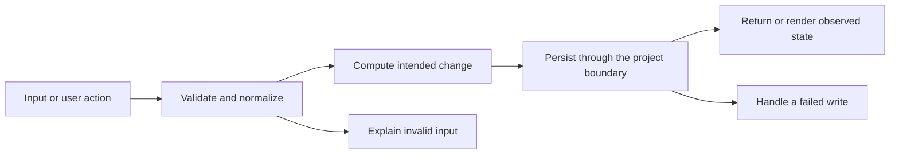

# Codebase map and reading order

[Course index](README.md)

## The problem this project solves

The category report reused a base query that selected expenses.* and then added GROUP BY categories.id. PostgreSQL cannot choose an arbitrary expense row for each category, so that report could fail. Date filters and amount edge cases also needed validation. The improvement you will study is: The category query clears the base projection before selecting category fields, SUM and COUNT. Report inputs reject malformed months, impossible dates and reversed ranges. The test fixture proves monthly, daily and category results agree at leap-day and month boundaries.

## Data model

Each expense belongs to one category and has a date and decimal amount. Monthly windows are half-open: first day inclusive, next month’s first day exclusive. Category range filters currently include both supplied start_date and end_date.

An object is a named collection of fields. An array is an ordered collection of values. An id answers “which record?”; an index answers “where is it in this array right now?” Those questions are different whenever the list can be filtered, reordered or edited. Persisted data is the form that must survive a process/page restart. Derived data can be recomputed from that persisted state.

## Trace one action

1. Stats routes receive a month or date range.
2. The service validates month/date/filter input.
3. The model selects only grouped fields and aggregates.
4. PostgreSQL computes sums and counts over the selected window.
5. The controller returns the success envelope.
6. The client renders totals and chart series.

This diagram names responsibilities, not necessarily separate files. A small browser program can keep them in app.js. A larger API spreads them across controllers, services and models. Follow the actual sequence above rather than assuming every repository has the same architecture.

## Where to read first

1. [server/src/models/expenseModel.js](../server/src/models/expenseModel.js): locate `byCategory` and read its inputs, branches and return/side effects.
2. [server/test/reports.test.cjs](../server/test/reports.test.cjs): read the scenario names before the helper code.
3. The root [README](../README.md): connect setup and the larger application workflow.

## Source navigation

- [client/src/App.jsx](../client/src/App.jsx)
- [client/src/components/ui/Button.jsx](../client/src/components/ui/Button.jsx)
- [client/src/main.jsx](../client/src/main.jsx)
- [client/src/services/api.js](../client/src/services/api.js)
- [client/vite.config.js](../client/vite.config.js)
- [server/db/migrations/202607030301_create_expense_tracker.js](../server/db/migrations/202607030301_create_expense_tracker.js)
- [server/db/seeds/001_expenses.js](../server/db/seeds/001_expenses.js)
- [server/knexfile.js](../server/knexfile.js)
- [server/src/app.js](../server/src/app.js)
- [server/src/config/db.js](../server/src/config/db.js)
- [server/src/config/env.js](../server/src/config/env.js)
- [server/src/controllers/budgetController.js](../server/src/controllers/budgetController.js)
- [server/src/controllers/categoryController.js](../server/src/controllers/categoryController.js)
- [server/src/controllers/expenseController.js](../server/src/controllers/expenseController.js)
- [server/src/controllers/statsController.js](../server/src/controllers/statsController.js)
- [server/src/middleware/errors.js](../server/src/middleware/errors.js)
- [server/src/models/expenseModel.js](../server/src/models/expenseModel.js)
- [server/src/routes/budgetRoutes.js](../server/src/routes/budgetRoutes.js)
- [server/src/routes/categoryRoutes.js](../server/src/routes/categoryRoutes.js)
- [server/src/routes/expenseRoutes.js](../server/src/routes/expenseRoutes.js)
- [server/src/routes/statsRoutes.js](../server/src/routes/statsRoutes.js)
- [server/src/server.js](../server/src/server.js)
- [server/src/services/expenseService.js](../server/src/services/expenseService.js)
- [server/src/utils/csv.js](../server/src/utils/csv.js)
- [server/src/utils/responses.js](../server/src/utils/responses.js)

## A practical reading technique

At each function boundary, write down the value coming in, the value going out and any side effect. A side effect includes a storage write, SQL query, network request, timer registration or DOM update. If a function calls another function, inspect only that next dependency until you can finish the chosen trace. Return to unrelated files later.

For this lesson, start with: **For February 2024 use Food 10.10 on Feb 1, Food 20.20 on Feb 29 and Travel 4.70 on Feb 15. Put 99 on Jan 31 and 777 on Mar 1. February total is 35.00 across three expenses; Food is 30.30 and Travel is 4.70. Adjacent-month rows must not leak in.** Mark where the id, time, amount or other important value changes representation. For example, JSON serializes values into text; a date field may be a calendar string; SQL aggregates may return a different type from individual rows. Representation changes are common bug locations.

## Check your understanding

Without reading the solution, answer: Who owns the mutable state? Which input is untrusted? Which function first decides whether the operation is valid? What survives reload or restart? What observation would prove that the operation partially failed? Point to a source file for each answer, rather than describing a generic app from memory.
