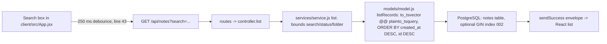

# Codebase map and reading order

[Course index](README.md)

## The problem this project solves

The API cast a whole row to text, and the UI searched serialized JSON locally. Internal metadata could match a document query. Payload field types were not enforced. The improvement you will study is: English to_tsvector/plainto_tsquery search uses bound parameters over title/body. The UI debounces requests and ignores older responses. Payloads and filters are bounded, tags serialize correctly to JSON, and partial edits retain omitted fields.

## Data model

Notes have title, body, folder, status and JSON tags. Search indexes the meaning of title/body; folder/status are independent exact filters, and internal ids/timestamps do not participate.

An object is a named collection of fields. An array is an ordered collection of values. An id answers “which record?”; an index answers “where is it in this array right now?” Those questions are different whenever the list can be filtered, reordered or edited. Persisted data is the form that must survive a process/page restart. Derived data can be recomputed from that persisted state.

## Trace one action

1. Debounce a search change.
2. Validate the text filters.
3. Construct a content vector and bound query.
4. Run the PostgreSQL search.
5. Publish only the newest request version.
6. Show searching or the matching count.

Every box is a file you can open; the arrows are the order a search request actually takes.

This diagram names responsibilities, not necessarily separate files. A small browser program can keep them in app.js. A larger API spreads them across controllers, services and models. Follow the actual sequence above rather than assuming every repository has the same architecture.

## Where to read first

1. [server/src/models/model.js](../server/src/models/model.js): locate `listRecords` and read its inputs, branches and return/side effects.
2. [server/test/search.test.cjs](../server/test/search.test.cjs): read the scenario names before the helper code.
3. The root [README](../README.md): connect setup and the larger application workflow.

## Source navigation

- [client/src/App.jsx](../client/src/App.jsx)
- [client/src/main.jsx](../client/src/main.jsx)
- [client/src/services/api.js](../client/src/services/api.js)
- [client/vite.config.js](../client/vite.config.js)
- [server/db/migrations/001_init.js](../server/db/migrations/001_init.js)
- [server/db/seeds/001_seed.js](../server/db/seeds/001_seed.js)
- [server/knexfile.js](../server/knexfile.js)
- [server/src/app.js](../server/src/app.js)
- [server/src/config/db.js](../server/src/config/db.js)
- [server/src/config/env.js](../server/src/config/env.js)
- [server/src/controllers/controller.js](../server/src/controllers/controller.js)
- [server/src/middleware/errorMiddleware.js](../server/src/middleware/errorMiddleware.js)
- [server/src/models/model.js](../server/src/models/model.js)
- [server/src/routes/routes.js](../server/src/routes/routes.js)
- [server/src/server.js](../server/src/server.js)
- [server/src/services/service.js](../server/src/services/service.js)
- [server/src/utils/errors.js](../server/src/utils/errors.js)
- [server/src/utils/response.js](../server/src/utils/response.js)

## A practical reading technique

At each function boundary, write down the value coming in, the value going out and any side effect. A side effect includes a storage write, SQL query, network request, timer registration or DOM update. If a function calls another function, inspect only that next dependency until you can finish the chosen trace. Return to unrelated files later.

For this lesson, start with: **Running notes matches search run through stemming. A note whose folder is HiddenKeyword does not match that content query. Invalid tags are rejected before writing. Updating only body retains title/id and makes its new words searchable.** Mark where the id, time, amount or other important value changes representation. For example, JSON serializes values into text; a date field may be a calendar string; SQL aggregates may return a different type from individual rows. Representation changes are common bug locations.

## Check your understanding

Without reading the solution, answer: Who owns the mutable state? Which input is untrusted? Which function first decides whether the operation is valid? What survives reload or restart? What observation would prove that the operation partially failed? Point to a source file for each answer, rather than describing a generic app from memory.
