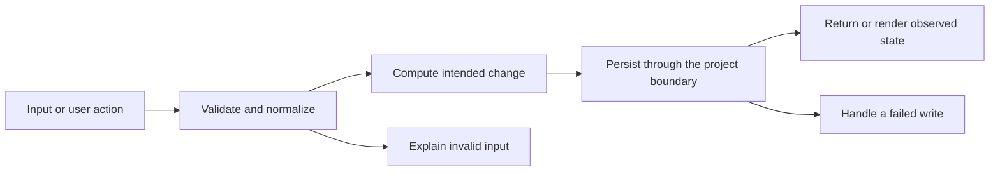

# Codebase map and reading order

[Course index](README.md)

## The problem this project solves

Ownership checks and transactions already existed, but the update ownership read happened outside the replacement transaction. Input parsing filtered some invalid child records instead of rejecting them and could throw ordinary TypeErrors for malformed values. The improvement you will study is: The update locks and checks ownership within the transaction. Nested input is validated without silently dropping invalid children. The model update also scopes by owner. Real HTTP tests deny a signed-in nonowner, and real foreign-key failures prove both create and replacement rollback.

## Data model

A recipe belongs to a user and has ingredients, steps and category links. Authentication identifies the caller. Authorization compares that caller with the stored owner. A graph replacement must commit the recipe and every dependent row together.

An object is a named collection of fields. An array is an ordered collection of values. An id answers “which record?”; an index answers “where is it in this array right now?” Those questions are different whenever the list can be filtered, reordered or edited. Persisted data is the form that must survive a process/page restart. Derived data can be recomputed from that persisted state.

## Trace one action

1. The auth middleware verifies the access token and supplies a user id.
2. The service opens a transaction for replacement.
3. The recipe row is locked and its owner is checked.
4. parseRecipeInput validates every ingredient and step.
5. saveRecipeGraph replaces parent and child rows through the transaction.
6. Commit publishes the graph; a later failure restores the original graph.

This diagram names responsibilities, not necessarily separate files. A small browser program can keep them in app.js. A larger API spreads them across controllers, services and models. Follow the actual sequence above rather than assuming every repository has the same architecture.

## Where to read first

1. [server/src/services/recipeService.ts](../server/src/services/recipeService.ts): locate `updateRecipeForUser` and read its inputs, branches and return/side effects.
2. [server/test/ownership.test.ts](../server/test/ownership.test.ts): read the scenario names before the helper code.
3. The root [README](../README.md): connect setup and the larger application workflow.

## Source navigation

- [client/src/App.tsx](../client/src/App.tsx)
- [client/src/components/ui/Button.tsx](../client/src/components/ui/Button.tsx)
- [client/src/context/AuthContext.tsx](../client/src/context/AuthContext.tsx)
- [client/src/main.tsx](../client/src/main.tsx)
- [client/src/pages/AuthPages.tsx](../client/src/pages/AuthPages.tsx)
- [client/src/pages/CreateRecipePage.tsx](../client/src/pages/CreateRecipePage.tsx)
- [client/src/pages/HomePage.tsx](../client/src/pages/HomePage.tsx)
- [client/src/pages/MyRecipesPage.tsx](../client/src/pages/MyRecipesPage.tsx)
- [client/src/pages/RecipeDetailPage.tsx](../client/src/pages/RecipeDetailPage.tsx)
- [client/src/services/api.ts](../client/src/services/api.ts)
- [client/src/services/recipes.ts](../client/src/services/recipes.ts)
- [client/src/types/recipe.ts](../client/src/types/recipe.ts)
- [client/src/vite-env.d.ts](../client/src/vite-env.d.ts)
- [client/vite.config.ts](../client/vite.config.ts)
- [server/db/migrations/001_initial_schema.ts](../server/db/migrations/001_initial_schema.ts)
- [server/db/seeds/001_seed.ts](../server/db/seeds/001_seed.ts)
- [server/knexfile.ts](../server/knexfile.ts)
- [server/src/app.ts](../server/src/app.ts)
- [server/src/config/db.ts](../server/src/config/db.ts)
- [server/src/config/env.ts](../server/src/config/env.ts)
- [server/src/controllers/authController.ts](../server/src/controllers/authController.ts)
- [server/src/controllers/recipeController.ts](../server/src/controllers/recipeController.ts)
- [server/src/middleware/asyncHandler.ts](../server/src/middleware/asyncHandler.ts)
- [server/src/middleware/auth.ts](../server/src/middleware/auth.ts)
- [server/src/middleware/errorHandler.ts](../server/src/middleware/errorHandler.ts)
- [server/src/models/recipeModel.ts](../server/src/models/recipeModel.ts)
- [server/src/models/userModel.ts](../server/src/models/userModel.ts)
- [server/src/routes/authRoutes.ts](../server/src/routes/authRoutes.ts)
- [server/src/routes/recipeRoutes.ts](../server/src/routes/recipeRoutes.ts)
- [server/src/server.ts](../server/src/server.ts)
- [server/src/services/authService.ts](../server/src/services/authService.ts)
- [server/src/services/recipeService.ts](../server/src/services/recipeService.ts)
- [server/src/types/domain.ts](../server/src/types/domain.ts)
- [server/src/types/express.d.ts](../server/src/types/express.d.ts)
- [server/src/utils/errors.ts](../server/src/utils/errors.ts)
- [server/src/utils/response.ts](../server/src/utils/response.ts)

## A practical reading technique

At each function boundary, write down the value coming in, the value going out and any side effect. A side effect includes a storage write, SQL query, network request, timer registration or DOM update. If a function calls another function, inspect only that next dependency until you can finish the chosen trace. Return to unrelated files later.

For this lesson, start with: **Alice creates a private Soup recipe with Water and a Boil step. Bob sends a valid token and a body claiming Alice’s user_id: the update must still fail with 403. Alice then attempts a replacement with a nonexistent category id; after failure, the original title, ingredient ids and steps must still exist unchanged.** Mark where the id, time, amount or other important value changes representation. For example, JSON serializes values into text; a date field may be a calendar string; SQL aggregates may return a different type from individual rows. Representation changes are common bug locations.

## Check your understanding

Without reading the solution, answer: Who owns the mutable state? Which input is untrusted? Which function first decides whether the operation is valid? What survives reload or restart? What observation would prove that the operation partially failed? Point to a source file for each answer, rather than describing a generic app from memory.
