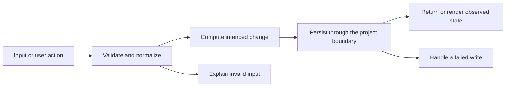

# Codebase map and reading order

[Course index](README.md)

## The problem this project solves

The scaffold copied fields without substantive runtime validation and lacked a metadata boundary. Emitted ESM paths also needed correction for a normal Node start. The improvement you will study is: Zod validates create and partial updates. Metadata accepts configured exact HTTPS hosts on port 443, validates public IPv4 DNS answers, pins the connection, rejects redirects, and bounds headers/body/time. The UI applies a proposed title only if its URL still matches the request.

## Data model

Bookmarks store title, URL, collection, status and JSON tags. Saving a URL never fetches it. Explicit metadata preview proposes a title and URL without saving a bookmark.

An object is a named collection of fields. An array is an ordered collection of values. An id answers “which record?”; an index answers “where is it in this array right now?” Those questions are different whenever the list can be filtered, reordered or edited. Persisted data is the form that must survive a process/page restart. Derived data can be recomputed from that persisted state.

## Trace one action

1. Explicitly request a page title.
2. Validate the URL and configured host.
3. Resolve and validate destination addresses.
4. Pin one public address for bounded transfer.
5. Parse only a successful bounded response.
6. Apply the title only if the form URL is unchanged.

This diagram names responsibilities, not necessarily separate files. A small browser program can keep them in app.js. A larger API spreads them across controllers, services and models. Follow the actual sequence above rather than assuming every repository has the same architecture.

## Where to read first

1. [server/src/services/metadata.ts](../server/src/services/metadata.ts): locate `fetchMetadata` and read its inputs, branches and return/side effects.
2. [server/test/metadata.test.ts](../server/test/metadata.test.ts): read the scenario names before the helper code.
3. The root [README](../README.md): connect setup and the larger application workflow.

## Source navigation

- [client/src/App.tsx](../client/src/App.tsx)
- [client/src/main.tsx](../client/src/main.tsx)
- [client/src/services/api.ts](../client/src/services/api.ts)
- [client/src/vite-env.d.ts](../client/src/vite-env.d.ts)
- [client/vite.config.ts](../client/vite.config.ts)
- [server/db/migrations/001_init.js](../server/db/migrations/001_init.js)
- [server/db/migrations/001_init.ts](../server/db/migrations/001_init.ts)
- [server/db/seeds/001_seed.js](../server/db/seeds/001_seed.js)
- [server/db/seeds/001_seed.ts](../server/db/seeds/001_seed.ts)
- [server/knexfile.js](../server/knexfile.js)
- [server/knexfile.ts](../server/knexfile.ts)
- [server/src/app.ts](../server/src/app.ts)
- [server/src/config/db.ts](../server/src/config/db.ts)
- [server/src/config/env.ts](../server/src/config/env.ts)
- [server/src/controllers/controller.ts](../server/src/controllers/controller.ts)
- [server/src/middleware/errorMiddleware.ts](../server/src/middleware/errorMiddleware.ts)
- [server/src/models/model.ts](../server/src/models/model.ts)
- [server/src/routes/routes.ts](../server/src/routes/routes.ts)
- [server/src/server.ts](../server/src/server.ts)
- [server/src/services/metadata.ts](../server/src/services/metadata.ts)
- [server/src/services/service.ts](../server/src/services/service.ts)
- [server/src/utils/errors.ts](../server/src/utils/errors.ts)
- [server/src/utils/response.ts](../server/src/utils/response.ts)

## A practical reading technique

At each function boundary, write down the value coming in, the value going out and any side effect. A side effect includes a storage write, SQL query, network request, timer registration or DOM update. If a function calls another function, inspect only that next dependency until you can finish the chosen trace. Return to unrelated files later.

For this lesson, start with: **A controlled host returns title A &amp; B, yielding A & B. A redirect to loopback is rejected without contacting its target. Private DNS, unlisted hosts, oversized bodies and timeouts fail. DNS finishing after timeout cannot start a transfer. A javascript: URL is rejected before insertion.** Mark where the id, time, amount or other important value changes representation. For example, JSON serializes values into text; a date field may be a calendar string; SQL aggregates may return a different type from individual rows. Representation changes are common bug locations.

## Check your understanding

Without reading the solution, answer: Who owns the mutable state? Which input is untrusted? Which function first decides whether the operation is valid? What survives reload or restart? What observation would prove that the operation partially failed? Point to a source file for each answer, rather than describing a generic app from memory.

## TypeScript migration and seed setup

From `server`, after `npm install` and configuring your development database, run `npm run migrate`, then `npm run seed`. The scripts load TypeScript through `tsx`. [knexfile.ts](../server/knexfile.ts) explicitly selects `.ts` migrations and seeds, so adjacent compiled `.js` copies are not executed as another migration. The [seed](../server/db/seeds/001_seed.ts) serializes tag arrays as JSON, just as the application database boundary does. Use seeding only on a disposable development database: the existing seed replaces bookmark rows.
