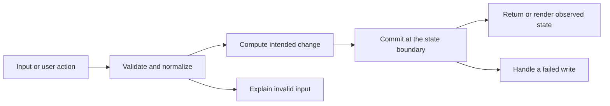

# Codebase map and reading order

[Course index](README.md)

## The problem this project solves

Request bodies reached database writes with weak validation; update forms used broad values, tag arrays were not consistently serialized for JSONB, and search responses could arrive out of order. The improvement you will study is: Create and partial-update schemas validate editable fields. Tags are trimmed, bounded and deduplicated; the model serializes JSON arrays explicitly. The typed form offers cancel, saves only editable fields, prevents duplicate submissions, retains failed drafts and ignores stale search results. Seed tags use the same explicit JSON serialization.

## Data model

Job Application Tracker stores applications with integer IDs and fields company, role, stage, status, tags. PostgreSQL persists rows; tags are JSONB. GET/POST /api/applications list/create and GET/PUT/DELETE /api/applications/:id read/change/remove a row. The success envelope wraps the record in data.

An object is a named collection of fields. An array is an ordered collection of values. An id answers “which record?”; an index answers “where is it in this array right now?” Those questions are different whenever the list can be filtered, reordered or edited. Persisted data is the form that must survive a process/page restart. Derived data can be recomputed from that persisted state.

## Trace one action

1. A React form, button or test sends a concrete operation.
2. The client serializes editable values as an HTTP request.
3. The server validates runtime input and the relevant record relationships.
4. The repository or model reads authoritative state and performs the documented change.
5. The storage boundary commits or rejects the operation.
6. The response or broadcast gives the client its observed result.

This diagram names responsibilities, not necessarily separate files. A small browser program can keep them in app.js. A larger API spreads them across controllers, services and models. Follow the actual sequence above rather than assuming every repository has the same architecture.

## Where to read first

1. [server/src/services/service.ts](../server/src/services/service.ts): locate `parsePayload` and read its inputs, branches and return/side effects.
2. [test/crud.test.ts](../test/crud.test.ts): read the scenario names before the helper code.
3. The root [README](../README.md): connect setup and the larger application workflow.

## Source navigation

- [client/src/App.tsx](../client/src/App.tsx)
- [client/src/main.tsx](../client/src/main.tsx)
- [client/src/services/api.ts](../client/src/services/api.ts)
- [client/src/types.ts](../client/src/types.ts)
- [client/src/vite-env.d.ts](../client/src/vite-env.d.ts)
- [client/vite.config.ts](../client/vite.config.ts)
- [server/db/migrations/001_init.ts](../server/db/migrations/001_init.ts)
- [server/db/seeds/001_seed.ts](../server/db/seeds/001_seed.ts)
- [server/knexfile.ts](../server/knexfile.ts)
- [server/scripts/database.ts](../server/scripts/database.ts)
- [server/src/app.ts](../server/src/app.ts)
- [server/src/config/db.ts](../server/src/config/db.ts)
- [server/src/config/env.ts](../server/src/config/env.ts)
- [server/src/controllers/controller.ts](../server/src/controllers/controller.ts)
- [server/src/middleware/errorMiddleware.ts](../server/src/middleware/errorMiddleware.ts)
- [server/src/models/model.ts](../server/src/models/model.ts)
- [server/src/routes/routes.ts](../server/src/routes/routes.ts)
- [server/src/server.ts](../server/src/server.ts)
- [server/src/services/service.ts](../server/src/services/service.ts)
- [server/src/utils/errors.ts](../server/src/utils/errors.ts)
- [server/src/utils/response.ts](../server/src/utils/response.ts)

## A practical reading technique

At each function boundary, write down the value coming in, the value going out and any side effect. A side effect includes a storage write, SQL query, network request, timer registration or DOM update. If a function calls another function, inspect only that next dependency until you can finish the chosen trace. Return to unrelated files later.

For this lesson, start with: **POST this synthetic input: {"company": "Company", "role": "Role", "stage": "applied", "status": "active", "tags": ["remote"]}. Then PUT only {"company":"Revised lesson"} to its ID and check the other fields remain. Tags ["API"," api "] produce one logical tag. Reject a numeric company and verify the row is unchanged; delete it and check a second delete returns 404.** Mark where the id, time, amount or other important value changes representation. For example, JSON serializes values into text; a date field may be a calendar string; SQL aggregates may return a different type from individual rows. Representation changes are common bug locations.

## Check your understanding

Without reading the solution, answer: Who owns the mutable state? Which input is untrusted? Which function first decides whether the operation is valid? What survives reload or restart? What observation would prove that the operation partially failed? Point to a source file for each answer, rather than describing a generic app from memory.
