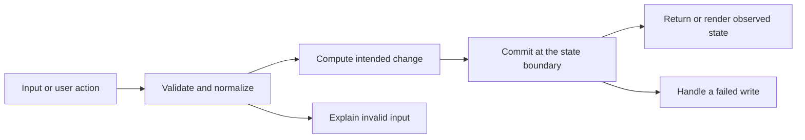

# Codebase map and reading order

[Course index](README.md)

## The problem this project solves

History, polling, reactions and group-management routes did not consistently verify membership. A duplicate member ID could break group creation. The improvement you will study is: A shared route guard verifies the demo user's membership for conversation/message operations, restricts group management to admins and validates read-receipt references. Group creation deduplicates members.

## Data model

Users join conversations through conversation_members, whose role is admin/member. Messages reference a conversation and author. Reactions reference a message and user. Read receipts store last_read_message_id on membership rows; typing indicators also reference conversation/user.

An object is a named collection of fields. An array is an ordered collection of values. An id answers “which record?”; an index answers “where is it in this array right now?” Those questions are different whenever the list can be filtered, reordered or edited. Persisted data is the form that must survive a process/page restart. Derived data can be recomputed from that persisted state.

## Trace one action

1. A React form, button or test sends a concrete operation.
2. The client serializes editable values as an HTTP request.
3. The server validates runtime input and the relevant record relationships.
4. The repository or model reads authoritative state and performs the documented change.
5. The storage boundary commits or rejects the operation.
6. The response or broadcast gives the client its observed result.

This diagram names responsibilities, not necessarily separate files. A small browser program can keep them in app.js. A larger API spreads them across controllers, services and models. Follow the actual sequence above rather than assuming every repository has the same architecture.

## Where to read first

1. [server/src/routes/chatRoutes.ts](../server/src/routes/chatRoutes.ts): locate `chatRouter.use` and read its inputs, branches and return/side effects.
2. [test/membership.test.ts](../test/membership.test.ts): read the scenario names before the helper code.
3. The root [README](../README.md): connect setup and the larger application workflow.

## Source navigation

- [client/src/App.tsx](../client/src/App.tsx)
- [client/src/main.tsx](../client/src/main.tsx)
- [client/src/services/api.ts](../client/src/services/api.ts)
- [client/src/types/chat.ts](../client/src/types/chat.ts)
- [client/src/vite-env.d.ts](../client/src/vite-env.d.ts)
- [client/vite.config.ts](../client/vite.config.ts)
- [server/db/migrations/001_init.ts](../server/db/migrations/001_init.ts)
- [server/db/seeds/001_seed.ts](../server/db/seeds/001_seed.ts)
- [server/knexfile.ts](../server/knexfile.ts)
- [server/scripts/database.ts](../server/scripts/database.ts)
- [server/src/app.ts](../server/src/app.ts)
- [server/src/config/db.ts](../server/src/config/db.ts)
- [server/src/config/env.ts](../server/src/config/env.ts)
- [server/src/controllers/chatController.ts](../server/src/controllers/chatController.ts)
- [server/src/index.ts](../server/src/index.ts)
- [server/src/middleware/errors.ts](../server/src/middleware/errors.ts)
- [server/src/middleware/validate.ts](../server/src/middleware/validate.ts)
- [server/src/models/chatModel.ts](../server/src/models/chatModel.ts)
- [server/src/routes/chatRoutes.ts](../server/src/routes/chatRoutes.ts)
- [server/src/services/chatService.ts](../server/src/services/chatService.ts)
- [server/src/utils/http.ts](../server/src/utils/http.ts)
- [server/src/validators/chatValidators.ts](../server/src/validators/chatValidators.ts)

## A practical reading technique

At each function boundary, write down the value coming in, the value going out and any side effect. A side effect includes a storage write, SQL query, network request, timer registration or DOM update. If a function calls another function, inspect only that next dependency until you can finish the chosen trace. Return to unrelated files later.

For this lesson, start with: **User 3 cannot read or poll the study room, react to its messages, type there or add members. User 2 can read and react but cannot manage members. A receipt pointing to another room is rejected. The author can edit/delete a message; a deleted message cannot be revived by editing.** Mark where the id, time, amount or other important value changes representation. For example, JSON serializes values into text; a date field may be a calendar string; SQL aggregates may return a different type from individual rows. Representation changes are common bug locations.

## Check your understanding

Without reading the solution, answer: Who owns the mutable state? Which input is untrusted? Which function first decides whether the operation is valid? What survives reload or restart? What observation would prove that the operation partially failed? Point to a source file for each answer, rather than describing a generic app from memory.
