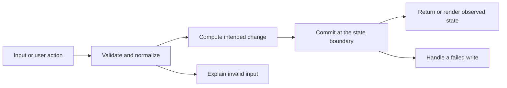

# Codebase map and reading order

[Course index](README.md)

## The problem this project solves

Activating a missing or another user's environment cleared the old active flag before failing. Duplicate variable keys could fail late, and writes could compete for active selection. The improvement you will study is: Environment create/update/activate serialize on the owner row. The target is verified before clearing active flags. Variable replacement locks its environment, rejects duplicate normalized keys and preserves the prior set on failure. Saved-request headers and parameters are serialized as JSONB arrays in seeds and CRUD writes.

## Data model

Users own environments, which own env_variables. Exactly one environment is selected through the application activation paths, unless the user explicitly deactivates all. Variables have key, value, is_secret and sort_order. Saved requests and proxy history are separate domains.

An object is a named collection of fields. An array is an ordered collection of values. An id answers “which record?”; an index answers “where is it in this array right now?” Those questions are different whenever the list can be filtered, reordered or edited. Persisted data is the form that must survive a process/page restart. Derived data can be recomputed from that persisted state.

## Trace one action

1. A React form, button or test sends a concrete operation.
2. The client serializes editable values as an HTTP request.
3. The server validates runtime input and the relevant record relationships.
4. The repository or model reads authoritative state and performs the documented change.
5. The storage boundary commits or rejects the operation.
6. The response or broadcast gives the client its observed result.

This diagram names responsibilities, not necessarily separate files. A small browser program can keep them in app.js. A larger API spreads them across controllers, services and models. Follow the actual sequence above rather than assuming every repository has the same architecture.

## Where to read first

1. [server/src/models/environmentModel.ts](../server/src/models/environmentModel.ts): locate `activateEnvironment` and read its inputs, branches and return/side effects.
2. [test/environments.test.ts](../test/environments.test.ts): read the scenario names before the helper code.
3. The root [README](../README.md): connect setup and the larger application workflow.

## Source navigation

- [client/src/App.tsx](../client/src/App.tsx)
- [client/src/components/ui/CodeEditor.tsx](../client/src/components/ui/CodeEditor.tsx)
- [client/src/features/collections/components/CollectionTree.tsx](../client/src/features/collections/components/CollectionTree.tsx)
- [client/src/features/environments/components/EnvironmentSelector.tsx](../client/src/features/environments/components/EnvironmentSelector.tsx)
- [client/src/features/history/components/HistoryPanel.tsx](../client/src/features/history/components/HistoryPanel.tsx)
- [client/src/features/request-builder/components/AuthEditor.tsx](../client/src/features/request-builder/components/AuthEditor.tsx)
- [client/src/features/request-builder/components/BodyEditor.tsx](../client/src/features/request-builder/components/BodyEditor.tsx)
- [client/src/features/request-builder/components/KeyValueEditor.tsx](../client/src/features/request-builder/components/KeyValueEditor.tsx)
- [client/src/features/request-builder/components/RequestConfigTabs.tsx](../client/src/features/request-builder/components/RequestConfigTabs.tsx)
- [client/src/features/request-builder/components/RequestTabs.tsx](../client/src/features/request-builder/components/RequestTabs.tsx)
- [client/src/features/request-builder/components/UrlBar.tsx](../client/src/features/request-builder/components/UrlBar.tsx)
- [client/src/features/response-viewer/components/ResponsePanel.tsx](../client/src/features/response-viewer/components/ResponsePanel.tsx)
- [client/src/main.tsx](../client/src/main.tsx)
- [client/src/pages/WorkbenchPage.tsx](../client/src/pages/WorkbenchPage.tsx)
- [client/src/services/api.ts](../client/src/services/api.ts)
- [client/src/types/index.ts](../client/src/types/index.ts)
- [client/src/utils/interpolate.ts](../client/src/utils/interpolate.ts)
- [client/src/vite-env.d.ts](../client/src/vite-env.d.ts)
- [client/vite.config.ts](../client/vite.config.ts)
- [server/db/migrations/20260703150000_create_api_tester.ts](../server/db/migrations/20260703150000_create_api_tester.ts)
- [server/db/seeds/001_api_tester_seed.ts](../server/db/seeds/001_api_tester_seed.ts)
- [server/knexfile.ts](../server/knexfile.ts)
- [server/scripts/database.ts](../server/scripts/database.ts)
- [server/src/app.ts](../server/src/app.ts)
- [server/src/config/db.ts](../server/src/config/db.ts)
- [server/src/config/env.ts](../server/src/config/env.ts)
- [server/src/controllers/collectionController.ts](../server/src/controllers/collectionController.ts)
- [server/src/controllers/environmentController.ts](../server/src/controllers/environmentController.ts)
- [server/src/controllers/historyController.ts](../server/src/controllers/historyController.ts)
- [server/src/controllers/proxyController.ts](../server/src/controllers/proxyController.ts)
- [server/src/middleware/errorMiddleware.ts](../server/src/middleware/errorMiddleware.ts)
- [server/src/middleware/requestContext.ts](../server/src/middleware/requestContext.ts)
- [server/src/middleware/validate.ts](../server/src/middleware/validate.ts)
- [server/src/models/collectionModel.ts](../server/src/models/collectionModel.ts)
- [server/src/models/environmentModel.ts](../server/src/models/environmentModel.ts)
- [server/src/models/historyModel.ts](../server/src/models/historyModel.ts)
- [server/src/models/requestModel.ts](../server/src/models/requestModel.ts)
- [server/src/routes/index.ts](../server/src/routes/index.ts)
- [server/src/server.ts](../server/src/server.ts)
- [server/src/services/collectionService.ts](../server/src/services/collectionService.ts)
- [server/src/services/environmentService.ts](../server/src/services/environmentService.ts)
- [server/src/services/historyService.ts](../server/src/services/historyService.ts)
- [server/src/services/proxyService.ts](../server/src/services/proxyService.ts)
- [server/src/types/express.d.ts](../server/src/types/express.d.ts)
- [server/src/utils/errors.ts](../server/src/utils/errors.ts)
- [server/src/utils/interpolate.ts](../server/src/utils/interpolate.ts)
- [server/src/utils/response.ts](../server/src/utils/response.ts)
- [server/src/validators/schemas.ts](../server/src/validators/schemas.ts)

## A practical reading technique

At each function boundary, write down the value coming in, the value going out and any side effect. A side effect includes a storage write, SQL query, network request, timer registration or DOM update. If a function calls another function, inspect only that next dependency until you can finish the chosen trace. Return to unrelated files later.

For this lesson, start with: **Activate a nonexistent environment and confirm Local remains active. Concurrently activate Local and Staging: only one ends active for that user. Replacing variables with KEY and spaced KEY returns 400 and preserves BASE_URL. Sending [] explicitly clears the owned environment.** Mark where the id, time, amount or other important value changes representation. For example, JSON serializes values into text; a date field may be a calendar string; SQL aggregates may return a different type from individual rows. Representation changes are common bug locations.

## Check your understanding

Without reading the solution, answer: Who owns the mutable state? Which input is untrusted? Which function first decides whether the operation is valid? What survives reload or restart? What observation would prove that the operation partially failed? Point to a source file for each answer, rather than describing a generic app from memory.
